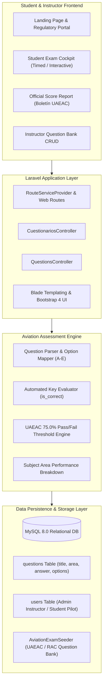
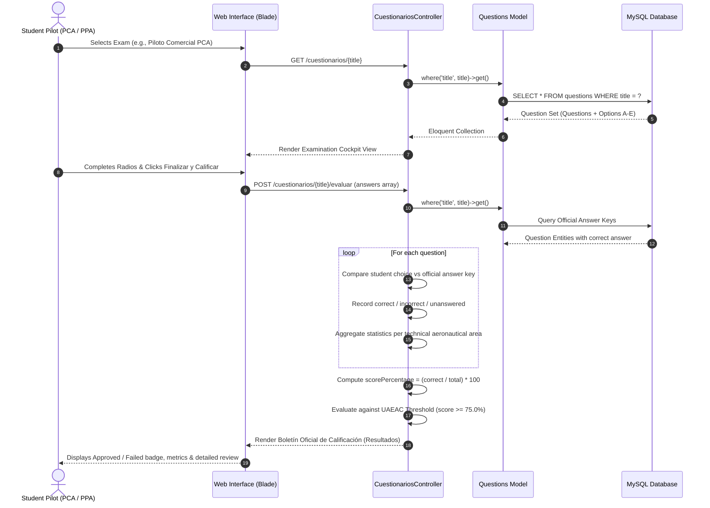

# Falcon Escuela de Aviación - Pilot Examination & Certification LMS

[](https://github.com/KevinAndrey96/laravel-falcon-flight-academy-exam-platform-lms/actions/workflows/ci.yml)
[](https://www.php.net/)
[](https://laravel.com/)
[](https://www.mysql.com/)
[](https://www.docker.com/)
[](https://www.aerocivil.gov.co/)
[](LICENSE)

Enterprise Learning Management System (LMS) and aeronautical examination assessment platform engineered for **Falcon Escuela de Aviación** (certified flight training academy in Colombia under UAEAC / RAC 141 standards).

The platform evaluates graduating student pilots for **Commercial Pilot (PCA - Piloto Comercial de Avión)**, **Private Pilot (PPA - Piloto Privado de Avión)**, and **Flight Operations Officers / Dispatchers (DPA)** licenses. It features a question bank management engine, interactive timed examination sessions, automated grading with official answer key validation, and subject-level performance metrics based on the official 75.0% passing threshold established by the Special Administrative Unit of Civil Aeronautics (UAEAC - Aeronáutica Civil de Colombia).

---

## 🧭 Institutional Background & Regulatory Context

**Falcon Escuela de Aviación** is an aviation instruction academy dedicated to training flight crew members and aviation personnel in Colombia. Pilot graduation and license endorsement require demonstrating theoretical proficiency before taking the official state examinations at the Aeronáutica Civil (UAEAC).

### Key Examination Pillars
- **Reglamentación Aeronáutica de Colombia (RAC 61 / RAC 91 / RAC 141)**: Flight time minimums, airspace classification (Class A-G), VFR/IFR fuel reserves, and crew flight duty limitations.
- **Aerodinámica y Principios de Vuelo**: Critical angle of attack, boundary layer separation, stall dynamics, load factors (G-load in banked turns), ground effect, and stability axes.
- **Meteorología Aeronáutica**: Decoding METAR and TAF reports, windshear recognition, microburst hazards, barometric altimetry (QNH, QNE, QFE), and convective thunderstorm hazards.
- **Navegación Aérea y Radionavegación**: VOR radial interception, DME arc navigation, NDB/ADF bearing resolution, GPS/GNSS procedures, magnetic variation vs deviation, and density altitude calculations.
- **Motores, Instrumentos y Sistemas de Aeronaves**: Pitot-static blockage error modes, dual magneto redundancy, constant-speed propellers, and vacuum gyroscopic flight instruments.
- **Factores Humanos y Gestión de Recursos en Cabina (CRM)**: Aeronautical Decision Making (ADM), hazardous attitude recognition and antidotes, hypoxia stages, and spatial disorientation.

---

## 🏗️ System Architecture



---

## 🔄 Examination & Scoring Sequence



---

## 📋 Aeronautical Knowledge Areas & Examination Matrix

| Area Técnica | Temas Evaluados (RAC / OACI) | Preguntas Semilla |
| :--- | :--- | :---: |
| **Reglamentación Aeronáutica de Colombia (RAC)** | Horas de vuelo PCA/PPA (RAC 61), reservas IFR/VFR (RAC 91), mínimos meteorológicos, espacio aéreo. | 4 |
| **Aerodinámica y Principios de Vuelo** | Ángulo crítico de ataque, pérdida (stall), factor de carga a 60 grados de banqueo, efecto suelo, fuerzas de vuelo. | 4 |
| **Meteorología Aeronáutica** | Decodificación de METAR/TAF, cortante de viento (windshear), microbursts, atmósfera estándar ISA (1013.25 hPa / 29.92 inHg). | 4 |
| **Navegación Aérea y Radionavegación** | Interceptación VOR radiales, OBS/CDI, altitud de densidad vs presión, rumbo verdadero a magnético (isógonas). | 3 |
| **Motores, Instrumentos y Sistemas** | Bloqueo de tubo Pitot / tomas estáticas, magnetos dobles independientes, hielo en carburador y pérdida de RPM. | 3 |
| **Factores Humanos y CRM** | Conciencia situacional (SA), altitudes de oxígeno suplementario, actitudes peligrosas y sus antídotos. | 2 |

---

## 🚀 Quick Start with Docker Compose

The platform is containerized with PHP 7.4 Apache and MySQL 8.0, including automated schema migrations and seed data.

### 1. Clone Repository
```bash
git clone git@github.com:KevinAndrey96/laravel-falcon-flight-academy-exam-platform-lms.git
cd laravel-falcon-flight-academy-exam-platform-lms
```

### 2. Launch Containers
```bash
docker compose up -d --build
```

The system will start:
- **Web Application**: [http://localhost:8099](http://localhost:8099)
- **MySQL Database**: `localhost:5439` (database: `falcon_flight_academy`, user: `falcon_user`, password: `falcon_secure_password`)

### 3. Access Seed Accounts
| Role | Email | Password | Access Level |
| :--- | :--- | :--- | :--- |
| **Flight Instructor (Admin)** | `admin@falconaviacion.edu.co` | `Falcon2024*` | Question Bank CRUD, Questionnaire Overview, Settings |
| **Student Pilot (User)** | `piloto@falconaviacion.edu.co` | `Piloto2024*` | Exam Execution, Scoring Analytics, Question Review |

---

## 🧪 Automated Testing Suite

The repository includes a dedicated test suite verifying scoring logic, threshold enforcement, and question bank consistency:

```bash
python3 scripts/test_exam_engine.py
```

Expected output:
```text
[*] Running Test 1: Perfect Score (100%)...
  -> Passed: Score 100%, Status Aprobado.
[*] Running Test 2: Passing Score exactly 75.0% (3 of 4 correct)...
  -> Passed: Score 75.0%, Status Aprobado.
[*] Running Test 3: Failing Score below threshold 50.0% (2 of 4 correct)...
  -> Passed: Score 50.0%, Status No Aprobado.
[*] Running Test 4: Unanswered answers (blank submissions)...
  -> Passed: 3 unanswered handled gracefully.

[SUCCESS] All 4 Aviation Exam Engine tests passed flawlessly!
```

---

## 📁 Repository Structure

```text
├── app/
│   ├── Http/Controllers/
│   │   ├── CuestionariosController.php   # Exam taking, answer comparison & scoring engine
│   │   ├── QuestionsController.php       # Instructor Question Bank CRUD
│   │   └── HomeController.php            # Pilot & Instructor dashboard
│   ├── Questions.php                     # Eloquent Model for aviation questions
│   └── User.php                          # User model with role authorization
├── database/
│   ├── migrations/                       # Database schema migrations
│   └── seeds/
│       ├── AviationExamSeeder.php        # UAEAC question bank seeders
│       └── DatabaseSeeder.php            # Root seeder invocation
├── docker/
│   └── init.sql                          # Turnkey SQL schema and seed data
├── resources/views/
│   ├── cuestionarios/
│   │   ├── index.blade.php               # Available questionnaires catalog
│   │   ├── cuestionario.blade.php        # Interactive examination cockpit view
│   │   └── resultados.blade.php          # Official Boletín de Calificación
│   ├── questions/
│   │   ├── index.blade.php               # Question bank data table
│   │   ├── create.blade.php              # New question creation form
│   │   └── edit.blade.php                # Question edit form
│   ├── layouts/app.blade.php             # Aeronautical cockpit theme layout
│   └── welcome.blade.php                 # Institutional landing portal
├── routes/
│   └── web.php                           # Application web routes
├── scripts/
│   └── test_exam_engine.py               # Standalone test runner
├── docker-compose.yml                    # Multi-container orchestration (ports :8099, :5439)
├── Dockerfile                            # PHP 7.4 Apache container
└── README.md
```

---

## 📄 License

This project is licensed under the [MIT License](LICENSE).
Official educational material developed for **Falcon Escuela de Aviación**.
